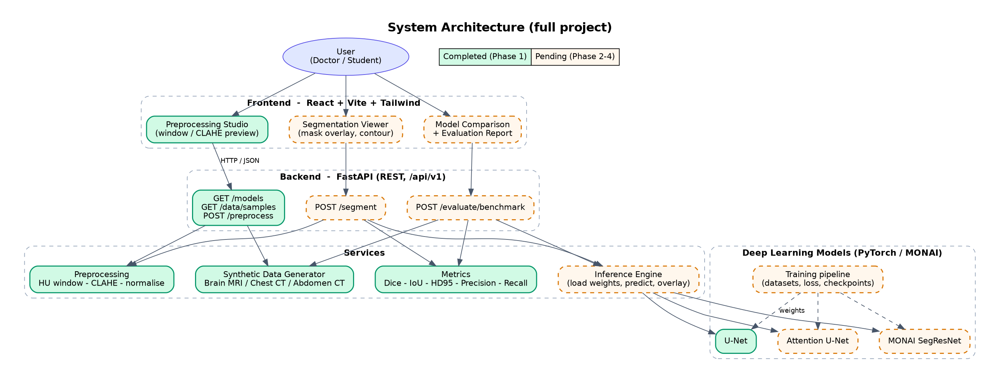
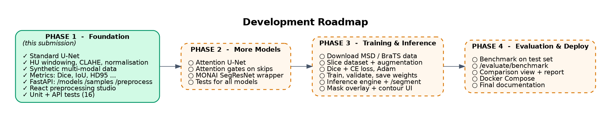
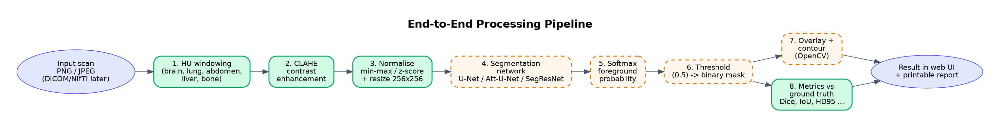
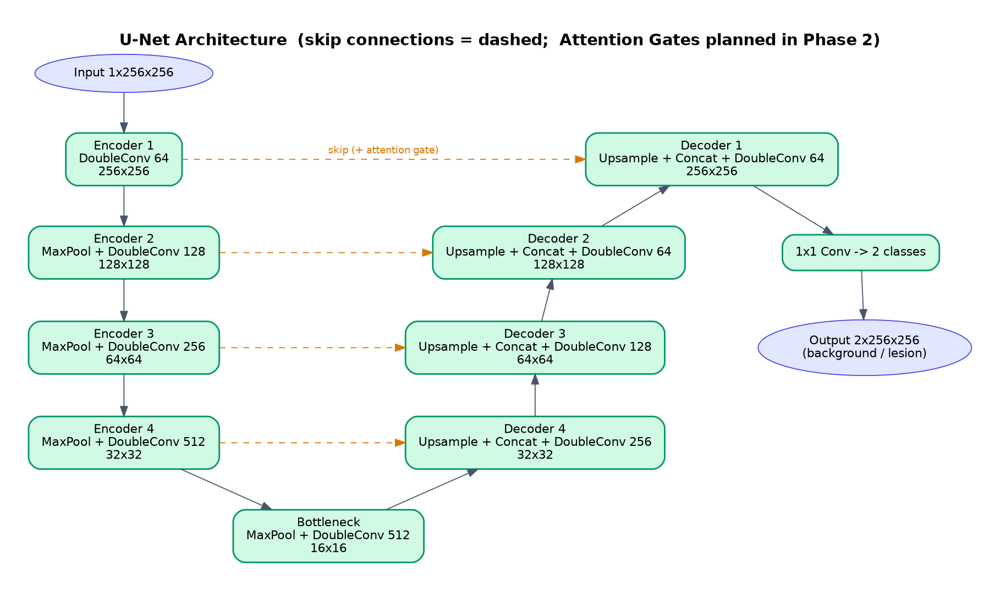

# Deep Learning-Based Medical Image Segmentation for Organ and Tumor Detection

> **Status: Work in progress - Phase 1 of 4 complete.**
> This repository is the *mid-term submission* of our major project. The foundation (data, preprocessing,
> U-Net, metrics, REST API, web UI) is finished and working. Model training, the remaining architectures and the
> evaluation dashboard are planned for the next phases and are described in detail in
> [Implementation Plan](#8-implementation-plan-how-we-will-finish-the-project).

**Team:** `<Name 1>`, `<Name 2>`, `<Name 3>`  |  **Guide:** `<Guide name>`  |  **Department / College:** `<Add here>`

---

## Table of Contents
1. [Problem statement & motivation](#1-problem-statement--motivation)
2. [Objectives](#2-objectives)
3. [Full system overview](#3-full-system-overview)
4. [Progress at a glance](#4-progress-at-a-glance)
5. [How the system works (concepts explained)](#5-how-the-system-works-concepts-explained)
6. [What is implemented in this submission (Phase 1)](#6-what-is-implemented-in-this-submission-phase-1)
7. [Setup & run](#7-setup--run)
8. [Implementation plan: how we will finish the project](#8-implementation-plan-how-we-will-finish-the-project)
9. [Tech stack](#9-tech-stack)
10. [Limitations & ethical note](#10-limitations--ethical-note)
11. [Future scope](#11-future-scope)

---

## 1. Problem statement & motivation

Doctors and radiologists look at CT and MRI scans to find organs and tumours. Outlining ("segmenting") a tumour by hand,
slice after slice, is slow, tiring and differs from one expert to another. Deep learning can produce a
**pixel-level mask** of the organ or tumour automatically, which can save time and make measurements (such as tumour
size) more consistent.

**Our project** builds an end-to-end platform that takes a medical scan, pre-processes it, segments the organ/tumour with
deep learning models, measures how good the result is, and shows everything in an interactive web dashboard.

## 2. Objectives

- Implement and compare several segmentation networks: **U-Net**, **Attention U-Net** and **MONAI SegResNet**.
- Build a medical **preprocessing** pipeline (CT Hounsfield-unit windowing, CLAHE, normalisation).
- Evaluate predictions with standard **quantitative metrics** (Dice, IoU, Precision, Recall, Specificity, HD95).
- Serve the models through a **REST API** (FastAPI) and visualise masks in a **React** dashboard.
- Support multiple modalities: **Brain MRI, Chest CT, Abdominal CT**.

## 3. Full system overview

The diagram shows the **complete planned system**. Green blocks are finished in this submission; dashed orange blocks are
planned.



**Layers**

| Layer | Responsibility |
|---|---|
| Frontend (React) | Lets the user pick a scan, tune preprocessing, view the mask overlay, compare models and print a report. |
| Backend API (FastAPI) | Receives requests, calls the services, returns JSON and base64 images. |
| Services | Preprocessing, synthetic data generation, metrics, inference engine. |
| Models (PyTorch / MONAI) | The neural networks that predict the mask. |
| Training pipeline | Trains the models on real datasets and saves the weights used by the inference engine. |

## 4. Progress at a glance



| Module | Status | Where |
|---|---|---|
| Standard U-Net | Done | `backend/app/models/unet.py` |
| CT windowing, CLAHE, normalisation | Done | `backend/app/services/preprocessing.py` |
| Synthetic Brain MRI / Chest CT / Abdominal CT generator | Done | `backend/app/services/synthetic_data.py` |
| Metrics (Dice, IoU, Precision, Recall, Specificity, HD95, volume difference) | Done | `backend/app/services/metrics.py` |
| REST API: `/models`, `/data/samples`, `/preprocess` | Done | `backend/app/api/endpoints/` |
| Web UI: Preprocessing Studio | Done | `frontend/src/` |
| Automated tests (16) | Done | `backend/tests/` |
| Attention U-Net | Planned (Phase 2) | `backend/app/models/attention_unet.py` (stub) |
| MONAI SegResNet | Planned (Phase 2) | `backend/app/models/monai_models.py` (stub) |
| Training on real data | Planned (Phase 3) | `backend/app/training/train.py` (stub) |
| Inference engine + `/segment` | Planned (Phase 3) | `backend/app/services/inference.py` (stub) |
| Benchmark + `/evaluate/benchmark`, comparison view, report | Planned (Phase 4) | `backend/app/api/endpoints/evaluate.py` (stub) |
| Docker deployment | Planned (Phase 4) | - |

## 5. How the system works (concepts explained)

### 5.1 Processing pipeline



1. **HU windowing** - CT values are stored in Hounsfield Units (air about -1000, water 0, bone > 300). A *window*
   (centre C, width W) keeps only the range useful for the organ being studied and stretches it to 0-255.
   Presets: brain (C40/W80), lung (C-600/W1500), abdomen (C40/W400), liver (C60/W160), bone (C400/W1800).
2. **CLAHE** - Contrast Limited Adaptive Histogram Equalisation boosts local contrast so tumour boundaries become clearer
   without over-amplifying noise.
3. **Normalisation and resize** - intensities are scaled to [0, 1] (min-max) or zero-mean/unit-variance (z-score) and
   the slice is resized to 256 x 256, the network input size.
4. **Segmentation network** - predicts, for every pixel, the score of being background or lesion.
5. **Softmax** - turns the scores into a foreground probability between 0 and 1.
6. **Threshold** - probability >= 0.5 becomes 1 (lesion), otherwise 0, giving a binary mask.
7. **Overlay and contour** - the mask is blended on the scan and its boundary is drawn with OpenCV.
8. **Metrics** - if a ground-truth mask exists, the prediction is scored against it.

### 5.2 U-Net



U-Net is an encoder-decoder network.

- The **encoder** repeatedly applies two 3x3 convolutions (with BatchNorm + ReLU) and a 2x2 max-pool. The image gets
  smaller (256 -> 16) while the number of feature channels grows (64 -> 512): the network learns *what* is in the image.
- The **decoder** up-samples step by step back to 256 x 256 to recover *where* it is.
- **Skip connections** copy encoder features directly to the decoder at the same resolution, so fine boundary detail is
  not lost. This is why U-Net works well even with small medical datasets.
- Our implementation has **17.26 M parameters** (bilinear up-sampling).

### 5.3 Attention U-Net (planned, Phase 2)

Plain skip connections pass *everything* from the encoder, including irrelevant background. An **Attention Gate**
learns a per-pixel weight `alpha` in [0, 1] and multiplies the skip features by it:

```
alpha  = sigmoid( psi( ReLU( W_g(g) + W_x(x) ) ) )     g = decoder (gating) signal, x = encoder skip features
output = x * alpha                                      -> background suppressed, tumour region emphasised
```

This is useful for small targets such as nodules and small tumours.

### 5.4 MONAI SegResNet (planned, Phase 2)

MONAI is a PyTorch framework for medical imaging. `SegResNet` is a residual encoder-decoder network from it, which we
use as a third, independent baseline for comparison.

### 5.5 Evaluation metrics

P = predicted mask, G = ground-truth mask.

```
Dice (DSC)   = 2 |P ∩ G| / (|P| + |G|)            overlap, 1 = perfect
IoU          = |P ∩ G| / |P ∪ G|                   Jaccard index
Precision    = TP / (TP + FP)                      how much of the prediction is correct
Recall       = TP / (TP + FN)                      how much of the real lesion is found
Specificity  = TN / (TN + FP)                      how well background is kept clean
HD95         = 95th percentile of the boundary distances between P and G   (pixels, lower is better)
Volume diff  = | |P| - |G| | / |G| x 100 %
```

## 6. What is implemented in this submission (Phase 1)

- **U-Net** (`models/unet.py`) with a forward pass verified for 256x256 and odd-sized inputs.
- **Preprocessing** (`services/preprocessing.py`): HU windowing presets, CLAHE (grayscale and colour), min-max and
  z-score normalisation, resizing. 8-bit demo images are first mapped to a *simulated* HU range
  (`intensity_to_pseudo_hu`); real DICOM/NIfTI CT data will already be in HU.
- **Synthetic data generator** (`services/synthetic_data.py`): Brain MRI (glioma), Chest CT (pulmonary nodule) and
  Abdominal CT (liver lesion) with ground-truth masks, so the pipeline can be tested without patient data.
- **Metrics** (`services/metrics.py`): all metrics above, unit-tested including a regression test for a uint overflow bug.
- **REST API** (FastAPI, interactive docs at `/docs`)

  | Method | Endpoint | Status |
  |---|---|---|
  | GET | `/api/v1/models` | Done - lists models with `implemented` / `planned` status |
  | GET | `/api/v1/data/samples` | Done - synthetic scans + ground-truth masks (base64) |
  | POST | `/api/v1/preprocess` | Done - original vs processed image + statistics |
  | POST | `/api/v1/segment` | Planned - returns HTTP 501 |
  | POST | `/api/v1/evaluate/benchmark` | Planned - returns HTTP 501 |

- **Web UI** (React + Tailwind): *Preprocessing Studio* - choose a synthetic scan or upload an image, pick a CT window,
  toggle CLAHE and see **original vs processed** instantly. Model zoo and progress cards show what is done and planned.
- **Tests**: 16 automated tests (model shapes, preprocessing, metrics, API).

> **Important:** the networks have **random, untrained weights** in this phase. The demo therefore does *not* report
> model accuracy. The metrics module is demonstrated by comparing a ground-truth mask with a deliberately shifted and
> eroded copy of itself. Real accuracy numbers will appear after training in Phase 3.

## 7. Setup & run

**Requirements:** Python 3.10+, Node.js 18+.

### 7.1 Verification demo (fastest way to see it work)
```bash
pip install -r backend/requirements.txt
python run_demo.py
```
It checks the U-Net, generates the three synthetic modalities, applies preprocessing, saves
`docs/images/preprocessing_preview.png` (original | windowed | CLAHE) and validates the metrics.

### 7.2 Backend
```bash
cd backend
pip install -r requirements.txt
uvicorn app.main:app --reload --port 8000
```
Open http://localhost:8000/docs for the interactive API.

### 7.3 Frontend
```bash
cd frontend
npm install
npm run dev
```
Open http://localhost:3000 (the dev server proxies `/api` to the backend on port 8000).

### 7.4 Tests
```bash
cd backend
python -m pytest -q
```

### 7.5 Suggested live-demo order
1. `python run_demo.py` - shows model, data, preprocessing and metrics working.
2. Start backend + frontend, open the *Preprocessing Studio*, switch between Brain MRI / Chest CT / Abdominal CT and try
   the window presets and CLAHE.
3. Show `/docs`: `/segment` and `/evaluate/benchmark` return **501 - planned**, which matches the roadmap.

## 8. Implementation plan: how we will finish the project

### Phase 2 - More models
1. Implement `AttentionGate` and `UpBlockAttention`, then `AttentionUNet` (same encoder as `UNet`, attention on all four skips).
2. Wrap `monai.networks.nets.SegResNet` (2D) with the same `forward(x) -> logits` signature.
3. Add shape tests for both. A shared interface lets one training and evaluation script handle every model.

### Phase 3 - Training and inference
1. **Data:** use the *Medical Segmentation Decathlon* (Task01 Brain Tumour, Task03 Liver, Task06 Lung) or BraTS. Read the
   NIfTI volumes with `nibabel`, extract 2D axial slices, apply the HU window for CT.
2. **Split:** 70 % train / 15 % validation / 15 % test **by patient**, never by slice, to avoid data leakage.
3. **Augmentation:** random flip, rotation, scaling, elastic deformation, brightness/contrast jitter.
4. **Training recipe:**

   | Item | Choice |
   |---|---|
   | Loss | Dice loss + Cross-Entropy |
   | Optimiser | Adam, learning rate 1e-4, `ReduceLROnPlateau` |
   | Batch / epochs | 8-16 / 50-100 with early stopping on validation Dice |
   | Hardware | free GPU (Google Colab or Kaggle) |
   | Output | best checkpoint per model in `backend/storage/weights/<model_id>.pt` |

5. **Inference engine:** load the weights, run the pipeline of section 5.1, return mask, overlay, area and probabilities.
6. **API/UI:** implement `POST /segment` and add the *Segmentation* tab with a mask overlay, contour and opacity slider.

### Phase 4 - Evaluation and deployment
1. Evaluate every model on the **held-out test set** and report mean +/- std of Dice, IoU, Precision, Recall and HD95
   per modality.
2. Implement `POST /evaluate/benchmark`, the *Model Comparison* tab (ground truth vs each model) and a printable *Evaluation Report*.
3. Add Docker Compose for one-command deployment and write the final documentation and project report.

### Suggested timeline
| Phase | Effort (suggested) |
|---|---|
| 2 - More models | 1-2 weeks |
| 3 - Training and inference | 3-4 weeks (data preparation + training is the longest part) |
| 4 - Evaluation and deployment | 1-2 weeks |

## 9. Tech stack

| Area | Technology |
|---|---|
| Deep learning | PyTorch (MONAI planned) |
| Image processing | OpenCV, NumPy, SciPy, Pillow |
| Backend | FastAPI, Uvicorn |
| Frontend | React 18, Vite, Tailwind CSS, lucide-react |
| Testing | pytest, FastAPI TestClient |
| Planned | MONAI, nibabel, pydicom, Docker |

## 10. Limitations & ethical note

- Models are untrained in Phase 1; no clinical or accuracy claim is made.
- The demo uses **synthetic** images, not real patient scans.
- This is an academic project and **not a medical device**; it must not be used for diagnosis or treatment decisions.
- When real data is used, the dataset licence must be followed and patient data must stay anonymised.

## 11. Future scope

3D segmentation of whole volumes, more organs and modalities (e.g. retinal scans), DICOM support, uncertainty estimation,
model explainability (Grad-CAM), and deployment on a hospital-grade PACS-compatible service.
